<div align="center">



<br/>

<a href="https://abdulgeni-abdulaziz.vercel.app"></a>
<a href="https://www.linkedin.com/in/abdulgeni-abdulaziz-7bb360401"></a>
<a href="mailto:abdulgeniabdulaziz@gmail.com"></a>
<a href="https://github.com/Abdulgeni"></a>

<br/><br/>


<br/>

<a href="#the-engineer">The Engineer</a> &nbsp;·&nbsp;
<a href="#now">Now</a> &nbsp;·&nbsp;
<a href="#proof-not-promises">Proof</a> &nbsp;·&nbsp;
<a href="#signature-work">Signature Work</a> &nbsp;·&nbsp;
<a href="#the-arsenal">Arsenal</a> &nbsp;·&nbsp;
<a href="#what-i-build-for-you">Services</a> &nbsp;·&nbsp;
<a href="#credentials">Credentials</a> &nbsp;·&nbsp;
<a href="#lets-talk">Contact</a>

</div>


<div align="center">

## The Engineer

</div>

**I build AI that holds up when it's used, not just when it's demoed.**

Self-taught and building since 2023, I design RAG systems, LLM agents, MCP servers and full-stack products, and I engineer them the hard way: atomic quotas, hardened inputs, idempotent payments, real test suites, and CI on every push. I have also trained and evaluated AI models at Postwork AI, so I know exactly where AI output breaks, and I build to catch it.

```python
class Abdulgeni:
    role      = "Full Stack AI Engineer"
    base      = "Addis Ababa, Ethiopia 🇪🇹  (UTC+3)"
    languages = ["English", "Arabic", "Turkish", "Amharic", "Afaan Oromo"]
    craft     = ["RAG & Agents", "MCP Servers", "Full-Stack SaaS", "Mobile", "Automation"]
    standard  = ["tested", "hardened", "documented"]
    education = "BSc CS & Engineering — ASTU (July 2027)"
    status    = "Open to remote contracts"

    def pitch(self):
        return "I don't demo. I ship. 🚀"
```

| At a glance | |
|---|---|
| 🧭 **Building since** | 2023 |
| 📦 **Public repositories** | 40+, with 20 live deployments |
| 🧪 **Standard** | Automated tests, CI and written docs on flagship repos |
| 🎓 **Education** | BSc Computer Science & Engineering, Adama Science and Technology University (expected July 2027) |
| 🗣️ **Languages** | English, Arabic, Turkish (fluent) · Amharic, Afaan Oromo (native) |

**Experience**

| Role | Where | When |
|---|---|---|
| **Independent Full Stack AI Engineer** | Self-directed products and open source | 2023 – Present |
| **AI Trainer & Code Quality Specialist** | Postwork AI (remote): rated model outputs, reviewed code, built n8n and Airtable workflows | Apr 2025 – END_DATE |
| **Front-end Intern → Internship Coordinator** | GoldenAge Technology PLC: leading 7 student interns on **OpsFlow**, an 8-module operations platform. I own two modules, wrote the SRS, and set up GitHub, CI and standups | 2025 – Present |


<div align="center">

## Now

</div>

- 🏢 **Leading** 7 student interns shipping OpsFlow at GoldenAge Technology PLC.
- 🌟 **Developing** Lumen, my AI summarization SaaS. It is pre-launch, with Stripe in test mode.
- 🎨 **Rebuilding** my portfolio from scratch, with only claims I can prove.
- 🌍 **Available** for remote freelance contracts and AI-data and evaluation work.


<div align="center">

## Proof, not promises

</div>

Everything below can be checked in the repositories.

| Project | The claim | The evidence |
|---|---|---|
| 🌟 **Lumen** | Credit quotas cannot be over-spent | An integration test fires 15 parallel requests at a 10-credit limit and exactly 10 succeed |
| 🏰 **Bastion** | Every internal hop is authenticated, encrypted and replay-protected | 296 tests, 5 gating scanners, 7 NIST SP 800-207 tenets. Its own pipeline caught two real leaks, and the fix is documented |
| ☸️ **KubeGuard** | Scans container images without ever running them | 361 tests, 97% coverage |
| 🔎 **Aegis** | Computes the minimum safe version for each vulnerable dependency | 460 tests, byte-identical output across 4 formats |
| 📋 **Field App** | Offline-first that survives crashes and wrong device clocks | 430+ tests, encryption verified on a real device |
| 🧾 **Invoice Scanner** | Layered architecture enforced by tooling, not convention | 483 tests, zero analyzer issues |


<div align="center">

## Signature Work

</div>

<table>
  <tr>
    <td width="50%" valign="top">
      <a href="https://github.com/Abdulgeni/lumen"></a>
      <br/><b>🌟 Lumen</b> · <a href="https://lumen-ai-saas.vercel.app/">live demo</a><br/>
      AI summarization SaaS: text, URL, PDF and DOCX in 20 languages. Atomic quotas, SSRF-hardened fetching, idempotent Stripe webhooks. Pre-launch, Stripe in test mode.<br/>
      <sub>Next.js 16 · React 19 · Prisma 7 · Better Auth · Stripe · Gemini</sub>
    </td>
    <td width="50%" valign="top">
      <a href="https://github.com/Abdulgeni/chat-widget"></a>
      <br/><b>💬 Embeddable Chat Widget</b> · <a href="https://chat-widget-abdulgeni.vercel.app/">live demo</a><br/>
      One script tag. Shadow DOM isolation, WebSocket streaming, PDF-grounded answers, domain allowlist, rate limiting, JWT and an admin dashboard.<br/>
      <sub>Next.js 16 · Gemini 2.5 Flash · SQLite</sub>
    </td>
  </tr>
  <tr>
    <td width="50%" valign="top">
      <a href="https://github.com/Abdulgeni/bastion"></a>
      <br/><b>🏰 Bastion</b><br/>
      Zero-trust service mesh: SPIFFE mTLS, Ed25519 JWTs with single-use replay protection, Vault-derived keys, fail-closed.<br/>
      <sub>296 tests · 5 gating scanners · NIST SP 800-207</sub>
    </td>
    <td width="50%" valign="top">
      <a href="https://github.com/Abdulgeni/Seller-mobile"></a>
      <br/><b>🛒 Halal Market</b><br/>
      Seller app: contract-first monorepo, offline mutation queue, idempotent 6-state payment and order machine modelled on Telebirr, CBE Birr and M-Pesa flows.<br/>
      <sub>React Native · Expo · Zod · TanStack Query · 99 tests</sub>
    </td>
  </tr>
  <tr>
    <td width="50%" valign="top">
      <a href="https://github.com/Abdulgeni/al-usra-gemstone"></a>
      <br/><b>💎 AL-USRA GEMSTONE</b> · <a href="https://al-usra-gemstone.vercel.app/">live</a><br/>
      Bilingual (EN/AR, RTL) catalogue for untreated Ethiopian gemstones: filterable gallery, embedded Sanity CMS, inquiry forms.<br/>
      <sub>Next.js 16 · Tailwind 4 · NextAuth · Resend</sub>
    </td>
    <td width="50%" valign="top">
      <a href="https://github.com/Abdulgeni/agentic-rag"></a>
      <br/><b>🧠 Agentic RAG</b><br/>
      An agent that refines its own queries iteratively and checks retrieval quality before it answers.<br/>
      <sub>Python · LangChain · ChromaDB · Streamlit</sub>
    </td>
  </tr>
</table>

<details>
<summary><b>📂 Open the full archive</b></summary>
<br/>

**🏢 Team and platform work**

| Project | Description | Stack |
|---|---|---|
| **[OpsFlow](https://github.com/Abdulgeni/opsflow-test)** · [live](https://opsflow-golden-age.vercel.app) | 8-module operations platform built by 7 interns I coordinate at GoldenAge. I own Property Management and Executive Decision Support | Next.js · NestJS · PostgreSQL · Prisma · Turborepo |
| **[OpsFlow Mobile](https://github.com/Abdulgeni/opsflow-mobile-app)** | Staff-only companion app: JWT sign-in, RBAC approvals, live comments, push notifications | Expo · Socket.IO · TanStack Query |

**🛡️ Security engineering**

| Project | Description | Evidence |
|---|---|---|
| **[KubeGuard](https://github.com/Abdulgeni/kubeguard)** | Docker image and Kubernetes manifest scanner, 13 rules | 361 tests · 97% coverage |
| **[Aegis](https://github.com/Abdulgeni/aegis)** | Lock-file vulnerability scanner (PyPI, npm, Go) on OSV.dev | 460 tests · SARIF output |
| **[PhishGuard](https://github.com/Abdulgeni/phishguard)** | FastAPI phishing URL and email classifier with bounded WHOIS lookups | 272 tests |
| **[Argus](https://github.com/Abdulgeni/argus)** | Log-anomaly CLI: IsolationForest, optional LLM summaries, secrets scrubbed before any prompt | 3 parsers · 3 report formats |

*Also: CI/CD pipelines with embedded security scanning added to 5+ of my repositories.*

**📱 Mobile**

| Project | Description | Stack |
|---|---|---|
| **[Field App](https://github.com/Abdulgeni/field_app)** | Offline-first data collection with encrypted storage and conflict resolution | Flutter · Dart shelf · 430+ tests |
| **[AI Assistant](https://github.com/Abdulgeni/ai_assistant)** | Arabic-first assistant: SSE streaming, RTL-safe UI, trigram Arabic search, voice | Flutter · Drift · 377 tests |
| **[Invoice Scanner](https://github.com/Abdulgeni/invoice_scanner-app)** | Camera capture, Gemini Vision extraction (demo extractor included), offline queue | Flutter · BLoC · Drift · 483 tests |

**🧠 RAG, agents and automation**

| Project | Description | Stack |
|---|---|---|
| **[Multi-Document RAG](https://github.com/Abdulgeni/multidoc-rag)** | Search across multiple PDFs with source attribution | Python · Sentence Transformers · ChromaDB |
| **[Multimodal RAG](https://github.com/Abdulgeni/multimodal-rag)** | Unified search over PDFs and images with CLIP embeddings | Python · CLIP · ChromaDB |
| **[WhatsApp Support Bot](https://github.com/Abdulgeni/support-bot)** | RAG knowledge base, multi-turn memory, human escalation | Python · LangChain · Twilio · ChromaDB |
| **[PR Review Bot](https://github.com/Abdulgeni/pr-review-bot)** | Reviews pull requests for bugs and security issues, comments on the PR | Python · Gemini · GitHub Actions · Slack |
| **[Invoice Extractor MCP](https://github.com/Abdulgeni/invoice-extractor-mcp)** | MCP server exposing invoice extraction as a tool for Claude Desktop | Python · MCP SDK · Gemini Vision |
| **[Invoice Extractor](https://github.com/Abdulgeni/invoice-extractor)** | Extracts vendor, amount, date and line items from invoice images | Next.js · TypeScript · Gemini |
| **[VulnAlert](https://github.com/Abdulgeni/vulnalert)** | Forwards Dependabot security events to Slack in about 5 seconds, across 7+ of my repos | n8n · Python · GitHub Webhooks · Slack |
| **[Email Automation](https://github.com/Abdulgeni/email-automation)** | Classifies email intent, drafts replies, notifies the team | n8n · OpenAI · Gmail |
| **[Social Automation](https://github.com/Abdulgeni/social-automation)** | Generates platform-specific posts and schedules them via Buffer | n8n · Gemini · Buffer |

</details>


<div align="center">

## The Arsenal


<br/><br/>

**AI and RAG**<br/>


**Automation**<br/>


**Web, mobile and payments**<br/>


**Security**<br/>


</div>


<div align="center">

## What I build for you

</div>

| | |
|---|---|
| 🧠 **RAG assistants and agents** | Knowledge-grounded chatbots and agents that cite their sources and know when not to answer |
| 🌐 **Full-stack web and SaaS** | Next.js and TypeScript products with auth, billing, tests and CI |
| 📱 **Mobile apps** | Flutter and React Native, offline-first when the field demands it |
| ⚙️ **Workflow automation** | n8n, Zapier, webhooks and GitHub Actions wired into the tools your team already uses |
| 🔍 **AI output and code evaluation** | Structured review of model responses and code quality, from my work at Postwork AI |
| 🛡️ **Secure-by-default builds** | OWASP Top 10 thinking from the first commit, not a patch at the end |


<div align="center">

## Credentials

[-4285F4?style=for-the-badge&logo=googlecloud&logoColor=white)](GOOGLE_CREDENTIAL_URL)
[](KAGGLE_ML_URL)
[](KAGGLE_PYTHON_URL)
[](KAGGLE_PANDAS_URL)
[](KAGGLE_ETHICS_URL)
<br/>
[-0A0A23?style=for-the-badge&logo=freecodecamp&logoColor=white)](FCC_ML_URL)
[](FCC_JS_URL)
[](FCC_FRONTEND_URL)
<br/>
[](CEH_COURSE_URL)
[](SECURITY_PLUS_PREP_URL)
[](DOCKER_URL)

<sub>The CEH and Security+ items are course completions and exam prep, not the EC-Council or CompTIA certifications.</sub>

</div>


<div align="center">

## Activity


</div>


<div align="center">

## Let's talk

**If you need someone who ships, and stands behind what they ship, write to me.**

RAG & agents · Full-stack development · AI automation · AI output and code evaluation

📩 **abdulgeniabdulaziz@gmail.com** &nbsp;·&nbsp; 🇪🇹 Addis Ababa (UTC+3) &nbsp;·&nbsp; 🗣️ English · Arabic · Turkish

<br/>


</div>
